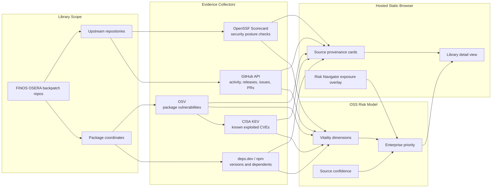

The OSS library-risk browser scores open source library health and enterprise
exposure side by side. It is seeded with FINOS OSERA `backpatch-*` repositories
as the initial library universe, with the `backpatch-` prefix removed and the
records scored against the upstream project where that upstream can be
identified.

## Hosted Browser

The browser is shipped as static website content:

```text
/oss-risk/browser.html
```

On GitHub Pages the full path is:

```text
https://finos-osera.github.io/risk-navigator/oss-risk/browser.html
```

On Netlify or an OSERA custom domain, the same static asset is served from
`/oss-risk/browser.html`. No additional hosting service or backend is required.

Individual records can be shared in two URL modes. Use
`?selected=<ecosystem>:<package>` to open the browser grid with the row
preselected, or `?p=<ecosystem>:<package>` to open the same record as a
project-focused full-detail page. For example,
`/oss-risk/browser.html?selected=maven:org.thymeleaf:thymeleaf` opens the
browser with Thymeleaf selected, while
`/oss-risk/browser.html?p=maven:org.thymeleaf:thymeleaf` opens Thymeleaf without
the aggregate grid.

## What It Shows

- OpenSSF Scorecard details, including a direct Scorecard viewer link and the
  lowest scoring checks.
- A unified Vulnerability Intelligence card combining OSV package-wide
  vulnerability summaries, CISA Known Exploited Vulnerabilities (KEV) enrichment
  derived from OSV CVE aliases, and version-specific published OSERA patch
  statements from the authoritative OSERA OpenVEX feed
  (`https://feed.finos.org/openvex.json`).
- Repository, package registry, and CHAOSS-derived project-health evidence.
- FINOS OSERA backpatch fork provenance and upstream repository links,
  explicitly distinguishing fork repository existence from published OpenVEX
  patch availability.
- Enterprise exposure overlaid from selected Risk Navigator datasets.

The enterprise overlay is not random fixture data. The browser reads the same
Risk Navigator collection manifest as the main tool and joins records by package
coordinate. Maven coordinates are matched as `groupId:artifactId`; other
ecosystems are matched by their package name where supported by the dataset.

## Data Flow



## Vitality Dimensions

The OSS vitality score is a weighted blend of five terms:

| Dimension | Weight | Meaning | Primary sources |
|---|---:|---|---|
| Project vitality | 25% | Recent upstream motion: commits, releases/tags, recent pushes, issue activity, and contributor activity. | GitHub API |
| Security health | 25% | Security process and vulnerability posture: OpenSSF Scorecard security checks, OSV vulnerability records, and CISA KEV matches. | OpenSSF Scorecard, OSV, CISA KEV |
| Sustainability and governance | 20% | Maintainership and governance signals: contributor depth, review flow, licensing, security policy presence, CII best-practices signal, and issue/PR response indicators. | OpenSSF Scorecard, GitHub-derived CHAOSS-style metrics |
| Dependency hygiene | 15% | Package maintenance and dependency-management health: latest/default version, release age, deprecated versions, dependency update tooling, pinned dependencies, and vulnerability checks. | deps.dev, npm, OpenSSF Scorecard |
| Ecosystem resilience | 15% | Ecosystem importance and support capacity proxy: dependent counts, download signal where available, stars/forks, contributor base, and recent activity. | deps.dev, npm downloads, GitHub API |

Enterprise priority starts from the health gap and then factors in ecosystem
criticality, selected Risk Navigator enterprise exposure, deployed-version risk,
and source confidence.

Undermaintenance pressure is a derived watch signal. It compares downstream
demand, such as registry dependents, download signal where available, and
internal application usage, against visible maintainer capacity from active
maintainers and recent contributors. Higher values mean many consumers appear to
depend on a project relative to the observed maintainer/contributor base. The
browser shows the value in Scoring Notes; it is not a table column. The default
grid sort is OSS vitality ascending, so weaker upstream health appears first.

## Source Semantics

Each source card includes a source name, confidence, links, and source-specific
evidence. Neutral cards mean a source was not applicable to that package
coordinate, not that the collector failed.

OSV needs a concrete package ecosystem. For ordinary package managers that means
ecosystems such as `Maven`, `npm`, `PyPI`, `Go`, `NuGet`, `RubyGems`, or
`crates.io`. For system libraries, OSV needs a distro-specific ecosystem. For
example, OpenSSL can be queried as `Debian/openssl`, `Ubuntu/openssl`,
`AlmaLinux/openssl`, or `Rocky Linux/openssl`; generic `system/openssl` or
`rpm/openssl` is intentionally rendered as not applicable.

OSV, CISA KEV, and the OSERA OpenVEX feed (`https://feed.finos.org/openvex.json`)
are presented together in a single `Vulnerability Intelligence` card with `OSV`,
`CISA KEV`, and `OSERA OpenVEX` tabs. CISA KEV matching uses CVE aliases returned
by OSV: when KEV matches exist, the card highlights with an alert border and
opens the `CISA KEV` tab by default; when OSV is not applicable or returns no
CVE aliases, KEV shows a disabled or no-match state without consuming a separate
source-card slot. The `OSERA OpenVEX` tab displays version-specific published
OSERA patch statements (`status: "fixed"`), deduplicating repeated historical
statements by `(purl, vuln_id, status, supplier)` and recording feed provenance
(`feed_version`, `feed_last_updated`, and retrieval timestamp). Presence of a
`finos-osera/backpatch-*` repository is kept distinct from whether a published
OSERA fix exists in the OpenVEX feed, and absence from the OpenVEX feed does not
mean zero vulnerabilities. A KEV match is a known-exploitation signal;
deployed-version impact still depends on the actual versions in the enterprise
inventory.

## Updating The Data

To run a full, fail-closed live refresh and validation locally (discovering `finos-osera/backpatch-*` seeds, bypassing the collector HTTP cache via `--refresh`, validating source provenance and distribution size limits in `data/local/oss-risk-refresh/publish`, and atomically updating `oss-risk/data/*.json` only when validation passes):

```bash
npm run refresh:oss-risk
```

To validate the committed `oss-risk/data/*.json` datasets without performing live network collection:

```bash
npm run validate:oss-risk
```

For individual collector runs during development, the focused OSERA dataset is generated with:

```bash
npm run collect:oss-risk:finos-osera
```

The smaller example dataset is generated with:

```bash
npm run collect:oss-risk
```

### Automated GitHub Actions Refresh & Publishing

1. **Workflow & Schedule**: `.github/workflows/refresh-oss-risk.yml` (`Refresh OSS-risk datasets`) runs weekly on schedule (`43 5 * * 1`) and on demand via `workflow_dispatch`.
2. **Credentials & Rate-Limit Handling**: The workflow supplies `GH_TOKEN` / `GITHUB_TOKEN` from `${{ github.token }}`. `refresh_oss_risk.py` requires an authenticated GitHub token (or `gh auth token` locally) and fails closed if GitHub API rate-limit/authentication errors (`HTTP 401`, `HTTP 403`, `HTTP 429`, `HTTP 5xx`) occur or if repository metadata lookups drop below the required success threshold.
3. **Cache Bypass & Provenance Retention**: Automated refreshes always execute with cache bypass enabled (`HttpClient(..., refresh=True)`), ensuring fresh upstream responses while writing `.meta.json` cache sidecars and recording `generated_at`, per-source `observed_at` / `retrieved_at` timestamps, and OSERA OpenVEX `feed_version` / `feed_last_updated` metadata.
4. **Fail-Closed Staging & Publication**: Refreshed datasets are written to `data/local/oss-risk-refresh/publish/` first and checked against minimum record counts, baseline shrink guards, schema/provenance requirements, OpenVEX/OSV/CISA KEV availability, and the 5 MiB per-file distribution cap. If any collector or validation check fails, the job exits non-zero and leaves the committed `oss-risk/data/*.json` snapshot untouched.
5. **Reviewable Refresh PR & Site Deployment**: When validation, `python -m pytest -q`, and `npm run docs:build` succeed, the workflow uploads the `oss-risk-datasets` build artifact and opens or updates a reviewable pull request from `codex/automated-oss-risk-refresh` (without auto-merging). Both `.github/workflows/pr-checks.yml` and `.github/workflows/pages.yml` watch `oss-risk/**`, so OSS-risk-data-only PRs run CI checks and merging the refresh PR automatically triggers the GitHub Pages deployment.
6. **Rerunning a Failed Refresh**: Maintainers can inspect the failed step in the **Refresh OSS-risk datasets** workflow logs and trigger a manual rerun from the GitHub Actions UI (**Run workflow** on `Refresh OSS-risk datasets`) or via `gh workflow run refresh-oss-risk.yml` once upstream API availability or rate limits recover.

The Docusaurus website build copies the browser and JSON datasets into
`website/static/oss-risk/` during `npm run docs:build`, so the hosted page is
kept in sync without changing `netlify.toml`.
